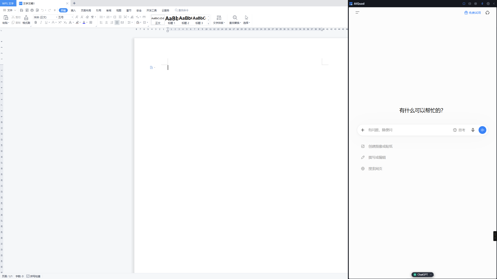
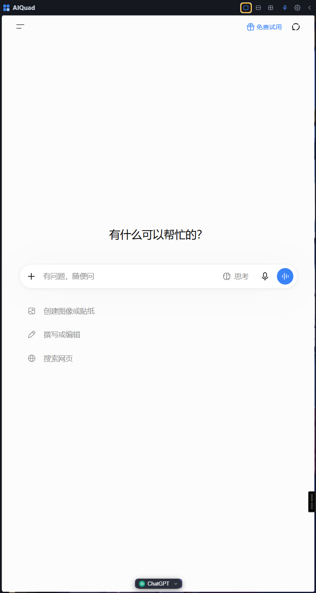
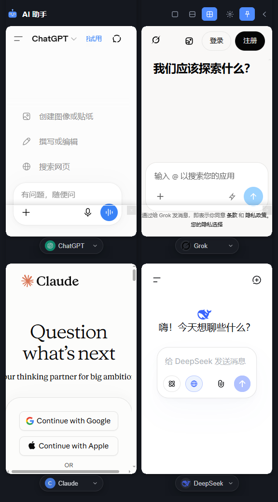

<p align="center">
  
</p>

<h1 align="center">AIQuad</h1>

<p align="center">
  Windows 多 AI 贴边面板 · 1/2/4 分格同开 · 共享登录态
</p>

<p align="center">
  <a href="https://github.com/WW-Ares/AIQuad/releases/latest"></a>
  
  
  
</p>

---

AIQuad 是一个面向 Windows 的 AI 快捷调用工具：按 `Alt+Space` 从任何窗口呼出贴边面板，在 1/2/4 个分格里同时使用 ChatGPT、Gemini、Claude、DeepSeek 等 AI。它不把网页塞进 webview，而是驱动真实的 Chrome / Edge 进程，再用 Win32 把浏览器窗口精确覆盖到分格区域。

> 每个分格都是一个真正的浏览器窗口。登录态天然持久、可跨分格共享，中文输入法和站点风控表现都和普通浏览器一致。

## 功能

- **`Alt+Space` 随时呼出**：贴边面板从屏幕边缘滑出，再按一次收起，不用回桌面找浏览器。
- **1 / 2 / 4 分格**：单页、上下两格、2×2 四格；每格独立选 AI，布局随时切换。
- **多 AI 切换**：内置 ChatGPT / Gemini / Grok / Claude / Perplexity / DeepSeek / Kimi / 千问 / 豆包 / 元宝 / 智谱清言，也可以自己添加站点。
- **登录一次，全格可用**：默认所有分格共用一份浏览器档案；关掉共享后，每格是独立档案，可同时挂多个账号。
- **位置与宽度可调**：左停 / 右停，20%–60% 宽度，滑块和预设即时生效。
- **代理设置**：跟随系统 / HTTP / HTTPS / SOCKS5 / 直连；共享会话下为进程级全局代理，关闭登录态共享后可按 AI 分流。
- **设置即时生效**：没有“保存并应用”，改完当场写入配置并返回保存状态。
- **缓存与闲置清理**：按档案查看体积，手动或自动清理 Cache / Code Cache；闲置分格可自动关闭，释放内存。
- **托盘常驻与自动更新**：关掉面板不退出；安装版启动后静默检查 GitHub Releases。
- **外链交给系统浏览器**：分格内点外部链接不会替换当前 AI 页面，站内链接仍然原地跳转。

## 界面截图

<p align="center">
  
</p>

<p align="center">
  
  
</p>

<p align="center">
  <sub>贴边单页 / 1 格 / 2×2 四格</sub>
</p>

## 安装

### 方式一：下载安装包

从 [Releases](https://github.com/WW-Ares/AIQuad/releases/latest) 下载：

- `AIQuad-Setup-*.exe`：安装版，支持自动更新。
- `AIQuad-Portable-*.exe`：便携版，解压即用，不写安装目录，不参与自动更新。

覆盖安装即可，配置和登录态保存在 `%APPDATA%\aiquad`，不会丢失。

> 安装包没有做代码签名，首次运行可能触发 Windows SmartScreen。点「更多信息」→「仍要运行」即可；也可以从源码自行构建。

### 方式二：源码运行

要求：Windows 10/11、Node.js 20+、本机已安装 Chrome 或 Edge。

```bash
npm install
npm run build
npm run dev
```

## 快速使用

1. 启动 AIQuad，按 `Alt+Space` 呼出面板。
2. 顶栏选择单页 / 上下两格 / 四格。
3. 点每格底部的 AI 切换器选择站点；第一次在某格登录后，其它格切到同一站点会直接复用登录态。
4. 打开设置页调整快捷键、代理、停靠方向、面板宽度、共享登录态和缓存策略。
5. 面板顶栏的图钉控制是否置顶；关掉后它就是一个普通窗口。

## 工作原理

AIQuad 没有使用 Electron 的 `<webview>` / BrowserView 加载网页，而是：

1. 启动真实的 Chrome / Edge 进程，为每个分格分配一个 page target；
2. 用 Win32 的顶级窗口 + 属主关系把浏览器窗口覆盖到分格矩形；
3. 用 30ms 几何看门狗持续校正位置、裁剪和层级；
4. 用 CDP 处理页面状态、链接拦截和自检；外部链接交给系统默认浏览器。

因此，站点看到的是一个普通浏览器窗口，而不是“应用内嵌浏览器”；登录态、输入法和站点兼容性都更接近日常使用。

更详细的架构、0px 对齐、四个 Win32 技巧和风控实测见 [docs/how-it-works.md](docs/how-it-works.md)。

> 本项目没有使用 `rtugeek/ai` 的任何源代码。它只是立项时的对照设计；本项目以 MIT 发布。

## 数据与配置

配置和浏览器档案都在：

```text
%APPDATA%\aiquad\
├─ config.json
├─ profiles\
├─ logs\main.log
└─ startup-state.json
```

- `profiles/` 里是各分格的浏览器档案；共享模式下共用 `profiles/shared`，独立模式按档案名分目录。
- `logs/main.log` 是主进程日志，排障时优先看这里。
- 设置页可以直接打开档案目录，并按目录查看 / 清理缓存。

## 从源码构建

```bash
npm install
npm run build     # 编译 TypeScript
npm run dev       # 启动源码版
npm run dist      # 打包 NSIS 安装包和便携版，输出到 build/
```

## 目录结构

```text
src/main/
  index.ts            应用生命周期 / 托盘 / 快捷键 / IPC
  instance-manager.ts 分格、浏览器实例、窗口几何、看门狗
  cdp.ts              CDP 连接、外链拦截、页面自检
  win32.ts            Win32 原生窗口定位
  config.ts           配置读写
  proxy.ts            代理参数与连通性测试
  cache-cleaner.ts    缓存统计与清理
src/renderer/         面板与设置页 UI
scripts/              自检、诊断、截图脚本
docs/                 架构说明、截图、发布说明
```

## 自检

大部分脚本不需要 Electron，可直接 `node` 跑：

```bash
node scripts/verify-shared.js            # 共享会话 / 裁剪 / 对齐 / Cookie 继承
node scripts/verify-settings.js          # 设置页端到端
node scripts/verify-shortcut-capture.js  # 快捷键抓取
node scripts/smoke.js                    # 浏览器探测 → 实例 → CDP → 窗口定位
node scripts/shot-packaged.js 45         # 打包版交付验收：截图 + 逐格对齐
```

更多脚本和排障工具见 [docs/how-it-works.md#自检脚本](docs/how-it-works.md#自检脚本)。

## 已知限制

- 代理是进程级设置。开启「登录态共享」时所有分格共用一个浏览器进程，只能走全局代理；要按 AI 分别走代理，需要关闭该开关。
- 「后台分格休眠」在共享会话下降级为隐藏窗口，因为挂起进程会把所有分格一起冻住，做不到只挂起一格。
- 关掉「登录态共享」后，每个分格是一个独立浏览器进程，4 格全开会占用较多内存。
- 改代理、窗口形态、共享开关需要重启浏览器实例。设置页保存时会等旧进程真正退出再重启。
- 浏览器窗口是独立的原生窗口，没法跟 Electron 页面做层叠。浮层只能靠“挖洞”让位，而且浮层出不了一格的边界。
- 分格宽度小于约 270px 时，部分站点（比如 ChatGPT）会自行切到窄屏版式，这是站点行为。
- 站点自己的弹层（比如 Gemini 的模型选择器）如果超出一格的范围，会被格子边界裁掉。
- 清理缓存时，浏览器正在占用的那部分文件删不掉，会跳过并在下次启动或退出时补上，不影响使用。

## 致谢与参考

### 对标项目

立项时我们拿 [`rtugeek/ai`](https://github.com/rtugeek/ai)（「桌面组件 Widgets」里的 AI 组件包）当对照对象。它用 Electron 内嵌 `<webview>` / BrowserView 加载 AI 网页，我们分析过它为什么会被 Google 判定成“应用内嵌浏览器”，最后选了相反的路线：不内嵌网页，直接驱动真实的 Chrome / Edge 进程。

> **本项目没有使用 `rtugeek/ai` 的任何源代码。** 它只是被当成“要避开的设计”来参考，所以本项目不受它 GPL-2.0 许可的约束。在这里提一下，一是说明技术选型是怎么来的，二是对先行者的尊重。

### 第三方依赖

| 依赖 | 用途 | 许可证 |
|---|---|---|
| [Electron](https://github.com/electron/electron) | 桌面壳：主进程 / 面板窗口 / 托盘 | MIT |
| [koffi](https://github.com/Koromix/koffi) | Node.js 调用 Win32 API（`user32` / `gdi32`） | MIT |
| [TypeScript](https://github.com/microsoft/TypeScript) | 开发语言 | Apache-2.0 |
| [electron-builder](https://github.com/electron-userland/electron-builder) | 打包 NSIS 安装包 | MIT |

### 图标

`src/renderer/assets/` 下的 AI 站点图标只用来标识跳转目标，版权和商标归各自品牌方所有（OpenAI、Google、xAI、Anthropic、Perplexity、DeepSeek、月之暗面、阿里云、字节跳动、腾讯、智谱 AI）。

## 贡献者

| 贡献者 | 角色 |
|---|---|
| [WW-Ares](https://github.com/WW-Ares) | 项目发起、产品方向与维护 |
| Codex（OpenAI） | AI 协作开发：架构设计、代码实现、测试与发布 |

## 许可证

[MIT](LICENSE) © 2026 WW-Ares、Codex 与 AI 协作
